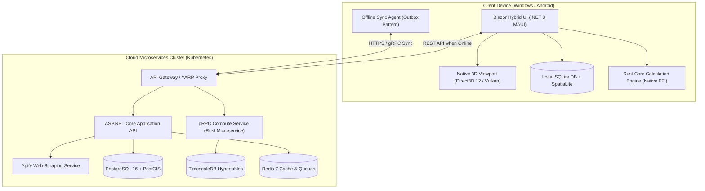
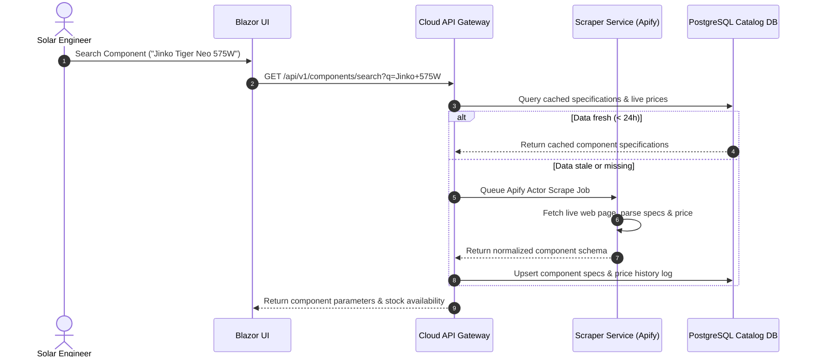
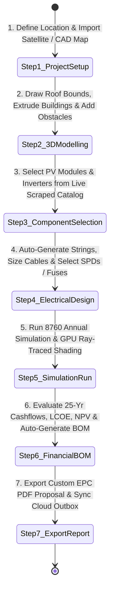

# Technical Specification Blueprint: Cross-Platform Solar PV Design & Simulation Software

## Executive Overview & System Objective

This document sets forth the comprehensive, production-grade technical architectural blueprint for a next-generation, cross-platform (**Windows Desktop & Android Mobile**) Solar PV Design and Simulation Software. Engineered as an all-in-one, EPC-grade solution, this platform rivals and surpasses the capabilities of legacy desktop tools (e.g., PVsyst) and web-only applications (e.g., Helioscope, Aurora Solar). 

It spans the full engineering lifecycle for **residential, commercial & industrial (C&I), agricultural, and utility-scale (power plant)** installations across **grid-tied, hybrid, and standalone off-grid** configurations.

---

## Document Map & Detailed Architectural Appendices

To ensure exhaustive depth, complete mathematical accuracy, and full schema specification, this specification is organized into a primary architectural blueprint supported by six specialized appendices:

```
docs/architecture/
├── TECHNICAL_SPECIFICATION.md                       # Master Architecture Specification (This Document)
└── appendices/
    ├── 01-architecture-and-c4.md                   # Tech Stack Justification, C4 Diagrams & Sync
    ├── 02-database-erd.md                          # Relational ERD, Data Dictionary & TimescaleDB
    ├── 03-api-contracts.md                         # OpenAPI 3.1 REST & gRPC Protobuf Definitions
    ├── 04-calculation-formulas.md                  # IEC/IEEE Math Formulas & Calculation Modules
    ├── 05-ui-ux-wireframes.md                      # UI Wireframes, ASCII Grid Layouts & Visuals
    └── 06-standards-traceability.md                # Requirements Traceability Matrix
```

### Appendices Summary Index
1. **[Appendix 01: Architecture & C4 Diagrams](appendices/01-architecture-and-c4.md)**: Deep-dive into technology stack choices (.NET 8 MAUI, Blazor Hybrid, Rust Core Engine), C4 Level 1–4 diagrams, offline-first synchronization architecture, sequence diagrams, and OAuth 2.0 / RBAC security models.
2. **[Appendix 02: Database ERD & Data Dictionary](appendices/02-database-erd.md)**: Database schemas for PostgreSQL 16 / PostGIS, TimescaleDB hypertable definitions for 8760 time-series data, local SQLite offline schema, and CRDT vector-clock conflict resolution policies.
3. **[Appendix 03: API Contracts](appendices/03-api-contracts.md)**: Complete OpenAPI 3.1 RESTful JSON specifications and high-performance gRPC `.proto` protocol definitions for multi-threaded simulation and 3D shading engines.
4. **[Appendix 04: Calculation Formulas & Engineering Modules](appendices/04-calculation-formulas.md)**: Rigorous mathematical equations with LaTeX formatting, assumptions, edge cases, and standard references for IEC 60364, IEC 62548, IEC 62305, IEEE 1547, Perez transposition, 3D BVH ray-casting, ASCE 7-16 structural loading, LCOE/NPV financial modeling, and BESS sizing. Includes validation test vectors.
5. **[Appendix 05: UI/UX Wireframes & Component Specifications](appendices/05-ui-ux-wireframes.md)**: User journey flowcharts, responsive UI design rules for Windows Desktop vs Android Mobile, ASCII grid wireframe mockups for key screens, and Razor component hierarchies.
6. **[Appendix 06: Standards Traceability Matrix](appendices/06-standards-traceability.md)**: End-to-end mapping matrix connecting requirements to software implementation modules, normative international standards, test vectors, and acceptance criteria.

---

## 1. High-Level Technology Stack & System Architecture

### 1.1 Definitive Technology Stack Matrix

| Architecture Layer | Selection | Technical Justification |
| :--- | :--- | :--- |
| **Cross-Platform UI** | `.NET 8 MAUI` + `Blazor Hybrid` | Single C# codebase targeting Windows (WinUI 3) and Android (API 26+). Blazor Hybrid enables 100% web UI component reuse (Razor/HTML5/CSS3) while native MAUI interop allows low-level access to device hardware, camera, GPS, and native window handles. |
| **3D Rendering Engine** | Native Direct3D 12 (Windows) / Vulkan & OpenGL ES 3.2 (Android) via Native MAUI View Handlers; `SkiaSharp` for 2D overlays | High-performance 3D viewport canvas for rendering complex photogrammetry meshes (>1M polygons), terrain heightmaps, and real-time ray-traced GPU shading. Eliminates WebGL overhead on mobile hardware. |
| **Core Computation Engine**| `Rust` (compiled to native `.dll` / `.so` via C FFI / `UniFFI`) | Provides memory safety, zero-cost abstractions, SIMD vectorization, and multi-threaded parallel execution for annual 8760-hour yield simulations and 3D shading ray-casting. Reused identically in local desktop client, mobile app, and backend cloud microservices. |
| **Cloud Application API**| `ASP.NET Core 8 Web API` + `gRPC` | Enterprise-grade backend providing REST/OpenAPI 3.1 endpoints for project CRUD/web dashboards and gRPC for binary streaming of high-density simulation vector data. |
| **Database Architecture** | `PostgreSQL 16` + `PostGIS 3.4` (Relational & Spatial) / `SQLite 3` (Client Offline DB) | PostgreSQL provides ACID compliance for project configurations, user RBAC, BOM inventories, and financial models. SQLite running inside the mobile/desktop app enables complete offline CRUD capabilities. |
| **Time-Series Storage** | `TimescaleDB 2.13` Extension | Hypertable partitioning optimized for sub-hourly meteorological irradiance data (GHI, DNI, DHI), 8760-hour annual simulation timeseries, and SCADA monitoring telemetry. |
| **Web Scraping Service** | Isolated Node.js Microservice with `Apify SDK` & `Playwright` | Dedicated background service interfacing with Apify Actors (Tienda Solar, SolarTraders) with built-in proxies, rate limiting, anti-bot protection, and legal compliance controls. |

---

### 1.2 Architectural System Layout

The platform follows a clean microservice & client-side hybrid offline-first architecture:



---

## 2. Product Database & Live Web Scraping Integration

The software provides a comprehensive component library containing over 50,000 verified PV panels, inverters, batteries, cables, fuses, and mounting structures.

### 2.1 Product Scraping & Catalog Pipeline
1. **Automated Scraping Execution**: The isolated Node.js microservice invokes Apify Actors targeting major e-commerce solar distributors (e.g., Tienda Solar, SolarTraders, Krannich, BayWa r.e.).
2. **Data Normalization**: Scraped datasheets are sanitized and normalized into canonical JSON schemas conforming to `COMPONENT_PV_MODULE` and `COMPONENT_INVERTER` table contracts.
3. **External API Integrations**: Direct API connectors ingest standardized Sandia National Laboratories (SAPM) and California Energy Commission (CEC) parameter datasets from **PVFree** and **pvlib**.



---

## 3. Core Engineering & Simulation Modules Summary

All engineering calculations in the platform are implemented in the high-performance **Rust Calculation Core (`libpv_engine`)** and strictly comply with international engineering standards:

```
====================================================================================================
ENGINEERING MODULES IN RUST CORE CALCULATION ENGINE
====================================================================================================

 1. ELECTRICAL MODULE (IEC 60364 / IEC 62548 / IEC 62305 / IEEE 1547)
    - DC & AC Cable Cross-Section Dimensioning (Current-carrying capacity & voltage drop)
    - Temperature-Corrected Voc,max (-40C to +70C site bounds)
    - String Overcurrent Fuse Sizing & DC/AC Surge Protection Device (SPD) Selection
    - Earthing Electrode Resistance & Direct Lightning Strike Risk Assessment
    - Voltage & Frequency Ride-Through Compliance Verification

 2. ENERGY YIELD & 3D SHADING MODULE (Perez Transposition / BVH Ray-Casting)
    - Perez Anisotropic Sky Model for Plane-of-Array (POA) Irradiance Transposition
    - GPU-Accelerated Bounding Volume Hierarchy (BVH) Ray-Traced 3D Shading Engine
    - Sandia SAPM Cell Temperature & CEC Inverter Efficiency Loss Models
    - 8760-Hour Sub-Hourly Annual Energy Yield Simulation & Loss Diagram Tree

 3. STRUCTURAL & MECHANICAL LOAD MODULE (ASCE 7-16 / Eurocode 1)
    - Ultimate Wind Velocity Pressure (q_z) & Net Uplift Pressure Calculations
    - Non-Penetrating Flat Roof Ballast Block Sizing (Overturning & Sliding Safety Factors)

 4. FINANCIAL & EPC COSTING MODULE (LCOE / NPV / IRR / Cashflows)
    - 25-Year Discounted Cashflow Modeling, Taxes (MACRS), Tariffs, & Degradation
    - Levelized Cost of Energy (LCOE), Net Present Value (NPV), & Internal Rate of Return (IRR)
    - Dynamic Bill of Materials (BOM) Generation with Live Scraped Pricing Integration

 5. OFF-GRID & BATTERY ENERGY STORAGE MODULE (BESS / IEEE 1562)
    - Standalone Battery Bank Capacity Sizing (Autonomy Days, DOD, Temp Derating)
    - MPPT Charge Controller & Array Peak Power Sizing for Seasonal Load Curves
====================================================================================================
```

*(For the complete mathematical formulations, LaTeX proofs, edge cases, and validation test vectors, refer to **[Appendix 04: Calculation Formulas & Engineering Modules](appendices/04-calculation-formulas.md)**).*

---

## 4. End-to-End User Workflow

The platform provides a streamlined 7-step user workflow transitioning seamlessly from initial field survey to final printable EPC proposal generation:



---

## 5. Non-Functional Requirements & Compliance Summary

### 5.1 Performance & Scalability Benchmarks
* **Instantaneous 3D CAD Interaction**: Render frame rate $\ge 60\,FPS$ on Windows (Direct3D 12) and Android (Vulkan) for scene models with up to $500,000$ polygons.
* **Rapid Simulation Execution**:
  * Residential System ($< 20\,kWp$): Full 8760-hour yield and shading simulation completes in $< 500\,ms$ locally.
  * Commercial System ($250\,kWp - 1\,MWp$): Simulation completes in $< 2.0\,seconds$ locally.
  * Utility Scale ($100\,MWp+$): Parallel ray-casting executed on cloud GPU compute nodes in $< 15.0\,seconds$.

### 5.2 Security & Data Integrity
* **Transport Security**: TLS 1.3 enforced across all REST and gRPC endpoints. SSL Certificate Pinning enabled on Android APKs.
* **Storage Encryption**: SQLCipher AES-256-GCM encryption for client local SQLite database; KMS-managed disk encryption for cloud PostgreSQL databases.
* **Authentication**: OIDC / OAuth 2.0 with JWT access tokens and secure biometric/keychain storage for refresh tokens.

### 5.3 Offline-First Reliability
* **100% Offline Capability**: Field engineers can create projects, draw spatial geometries, perform local string calculations, run local yield simulations, and generate draft reports without network connectivity.
* **Transactional Outbox Sync**: Unsynced modifications are recorded in an SQLite `OfflineOutbox` table and synced automatically with CRDT vector-clock conflict resolution upon reconnecting.

---

## Appendices Index & Quick Links

For complete technical schemas, code protocols, layout mockups, and calculation formulas, please refer directly to the supplementary appendix files:

* **[Appendix 01: System Architecture & C4 Diagrams](appendices/01-architecture-and-c4.md)**
* **[Appendix 02: Database ERD, Data Dictionary & Offline Sync Schemas](appendices/02-database-erd.md)**
* **[Appendix 03: API Contracts (OpenAPI 3.1 & gRPC Protocols)](appendices/03-api-contracts.md)**
* **[Appendix 04: Calculation Formulas & Engineering Modules Specification](appendices/04-calculation-formulas.md)**
* **[Appendix 05: UI/UX Wireframes & Component Layout Specifications](appendices/05-ui-ux-wireframes.md)**
* **[Appendix 06: Standards Traceability Matrix](appendices/06-standards-traceability.md)**
