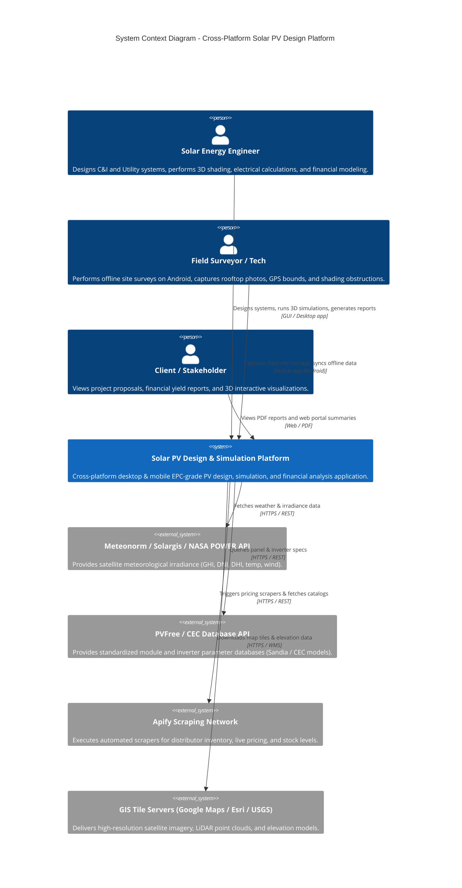
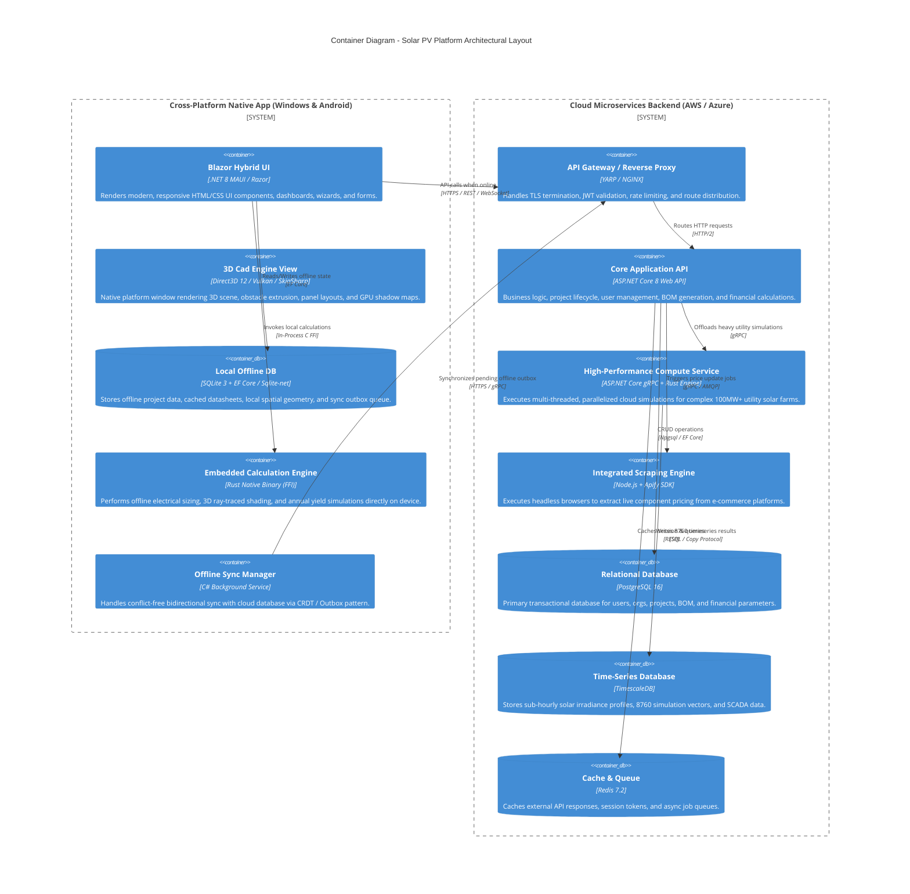
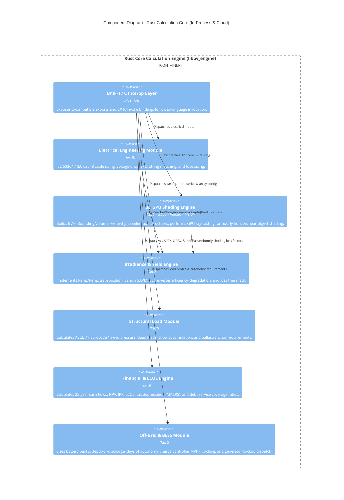
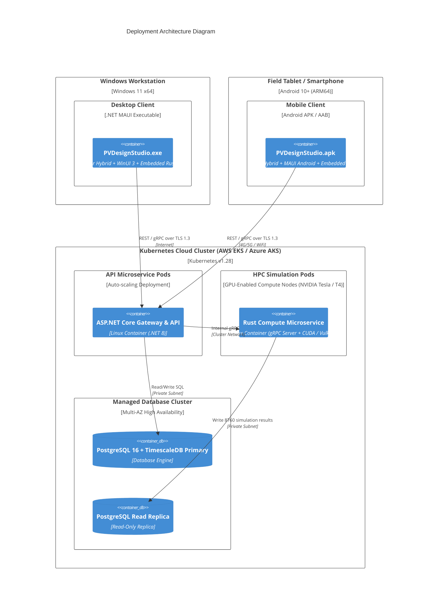
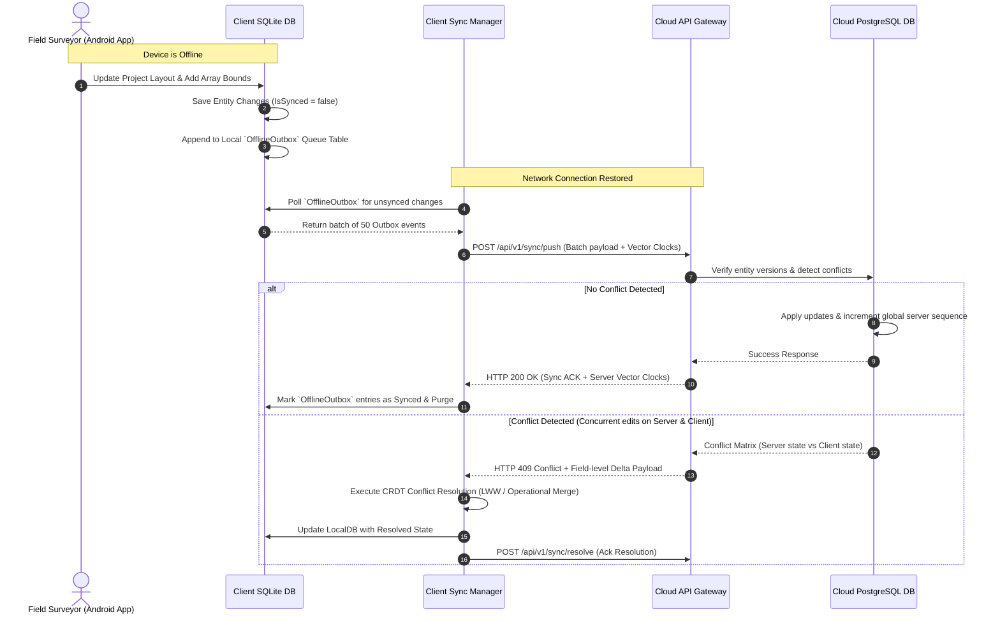
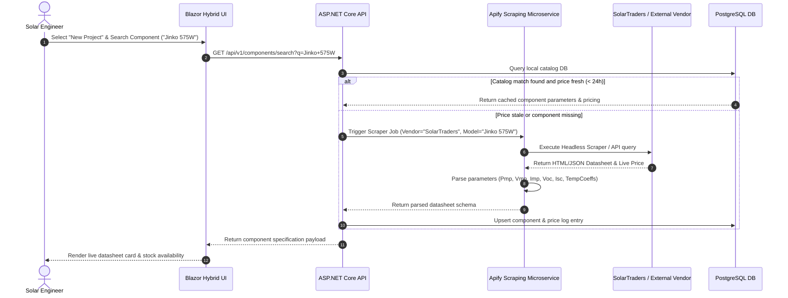
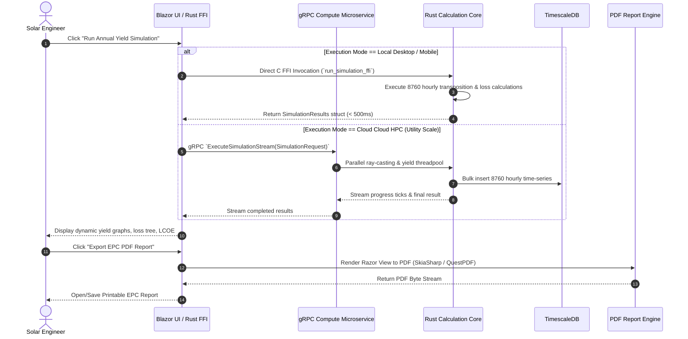

# Appendix 01: System Architecture & C4 Diagrams

## 1. Executive Summary & Tech Stack Justification

The next-generation Solar PV Design & Simulation Software is architected as an all-in-one, cross-platform (Windows Desktop & Android Mobile), EPC-grade engineering platform. It provides desktop-class performance for intensive 3D CAD modeling, ray-traced shading, and high-frequency energy yield calculations while ensuring full offline-first functionality for mobile field engineers.

### 1.1 Technology Stack Architecture Matrix

| Layer / Component | Technology Selected | Technical Justification |
| :--- | :--- | :--- |
| **Cross-Platform UI** | `.NET 8 MAUI` + `Blazor Hybrid` | Single C# codebase targeting Windows (WinUI 3) and Android (API 26+). Blazor Hybrid enables 100% web UI component reuse (using WebAssembly/Razor) across platforms, while MAUI native interop allows low-level access to device hardware, camera, GPS, and native window handles. |
| **3D Rendering & CAD View** | Native Direct3D 12 (Windows) / Vulkan & OpenGL ES 3.2 (Android) via Native MAUI View Handlers; `SkiaSharp` for 2D overlays | High-performance 3D canvas for handling heavy photogrammetry meshes (>1M polygons), terrain heightmaps, and real-time ray-traced GPU shading. Eliminates WebGL overhead on mobile hardware. |
| **Core Calculation Engine** | `Rust` (compiled to `.dll` / `.so` / `.a` via `UniFFI` / C FFI) | Provides memory safety, zero-cost abstractions, SIMD vectorization, and multi-threaded parallel execution for annual 8760-hour yield simulations and 3D shading ray-casting. Reused identically in local desktop client, mobile app, and backend cloud microservices. |
| **Cloud Backend Service** | `ASP.NET Core 8 Web API` + `gRPC` | High-throughput, enterprise-grade backend providing REST/OpenAPI 3.1 endpoints for web dashboards and gRPC for binary streaming of high-density simulation vector data. |
| **Primary Relational DB** | `PostgreSQL 16` (Cloud) / `SQLite 3` (Client Offline DB) | PostgreSQL provides ACID compliance for project configurations, user RBAC, BOM inventories, and financial models. SQLite running inside the mobile/desktop app enables complete offline CRUD capabilities. |
| **Time-Series DB** | `TimescaleDB` extension on PostgreSQL / `InfluxDB v3` | Optimized for sub-hourly meteorological irradiance data (GHI, DNI, DHI), 8760-hour annual simulation timeseries, and SCADA monitoring telemetry. |
| **In-Memory Cache & Queue**| `Redis 7.2` | Distributed caching of manufacturer datasheets, scraping session locks, and background execution job queue state (via `Hangfire` or `MassTransit`). |
| **Web Scraping Service** | Isolated Node.js Microservice with `Apify SDK` & `Playwright` | Dedicated background service that interfaces with Apify Actors (Tienda Solar, SolarTraders) with built-in proxies, rate limiting, anti-bot protection, and circuit breakers. |

---

## 2. C4 Architecture Diagrams

### 2.1 C4 Level 1: System Context Diagram

The following diagram illustrates how external users (Solar Engineers, Field Surveyors, Clients) and third-party services interact with the Solar PV Platform.

---

### 2.2 C4 Level 2: Container Diagram

The Container Diagram details the internal architectural boundary of the platform across Client (Desktop/Mobile) and Cloud Backend environments.

---

### 2.3 C4 Level 3: Component Diagram (Core Calculation Engine)

This diagram focuses on the Rust Core Calculation Engine and how its constituent sub-modules process inputs to generate engineering outputs.

---

### 2.4 C4 Level 4: Deployment Diagram

---

## 3. Offline-First Synchronization Architecture

Field engineers operating in remote regions must be able to perform site surveys, capture obstacle dimensions, define array boundaries, select components, run local shading/yield estimates, and capture photos without an active internet connection.

### 3.1 SQLite Local Schema & Hybrid Outbox Sync Pattern

1. **Local State Persistence**: All application state on desktop and mobile is written locally to an SQLite database managed via Entity Framework Core and `sqlite-net`.
2. **Transactional Outbox Queue**: When offline modifications occur (e.g., project update, component addition, site photo capture), an entry is appended to the `OfflineOutbox` queue table within a single local database transaction.
3. **Optimistic Concurrency Control (OCC) with Vector Clocks**: Every synced entity contains a `version_vector` (JSON dictionary mapping `client_id` to monotonic integer `sequence_number`) and a `server_updated_at` timestamp.

### 3.2 Conflict Resolution Policy

| Entity Type | Conflict Resolution Rule | Description |
| :--- | :--- | :--- |
| **Site Survey Photos / Attachments** | Append / Union | Photos captured offline are never overwritten. Filename uses UUIDv4 + Timestamp. |
| **3D Geometry / Array Layouts** | Last-Write-Wins (LWW) by Timestamp | Resolved using the highest UTC timestamp. If modified by both simultaneously, a design scenario branch (e.g., `Scenario_Survey_Sync_1`) is auto-created. |
| **BOM / Component Selections** | Last-Write-Wins (Field Level) | Field-level delta merging. If Client A changed Panel model and Client B changed Cable length, both modifications are preserved. |
| **Financial Parameters** | Server Deterministic Win | Financial tax parameters, tariff rates, and discount factors updated by office admins supersede field edits. |

---

## 4. Security Architecture & RBAC Matrix

### 4.1 Authentication & Transport Security
* **Authentication Standard**: OpenID Connect (OIDC) & OAuth 2.0 framework integrated with IdentityServer / Auth0 / Azure AD B2C.
* **Token Management**:
  * **Access Token**: Short-lived JWT (15-minute validity) signed using RS256 / Ed25519.
  * **Refresh Token**: Long-lived sliding window token (30 days) stored securely in `Windows Credential Manager` (Desktop) and `Android KeyStore / EncryptedSharedPreferences` (Mobile).
* **Data Encryption**:
  * **In Transit**: TLS 1.3 enforced across all REST and gRPC channels with TLS Certificate Pinning implemented in mobile APKs.
  * **At Rest**: SQLCipher (AES-256-GCM) for local SQLite client database encryption; AWS KMS / Azure Key Vault managed keys for server PostgreSQL disks.

### 4.2 Role-Based Access Control (RBAC) Matrix

| Permission / Functionality | Administrator | Principal Solar Engineer | Field Surveyor | Procurement Manager | Client / Auditor |
| :--- | :---: | :---: | :---: | :---: | :---: |
| **Manage Users & Org Settings** | **Full** | Read Only | No Access | No Access | No Access |
| **Create/Edit 3D CAD Sites** | **Full** | **Full** | **Full** | Read Only | Read Only |
| **Run Yield & Shading Simulations**| **Full** | **Full** | Basic (Presets) | No Access | Read Only |
| **Modify Electrical / Standards Config**| **Full** | **Full** | No Access | No Access | No Access |
| **Execute Component Scraper & Pricing**| **Full** | **Full** | No Access | **Full** | No Access |
| **Approve Financial Model & BOM** | **Full** | **Full** | No Access | Edit BOM Costs | Read Only |
| **Export Official EPC PDF Reports**| **Full** | **Full** | Draft Only | Draft Only | Download Final |
| **Purge / Delete Projects** | **Full** | Soft Delete | No Access | No Access | No Access |

---

## 5. System Sequence Diagrams

### 5.1 Project Creation & Component Scraping Workflow

### 5.2 Simulation & Report Generation Workflow

