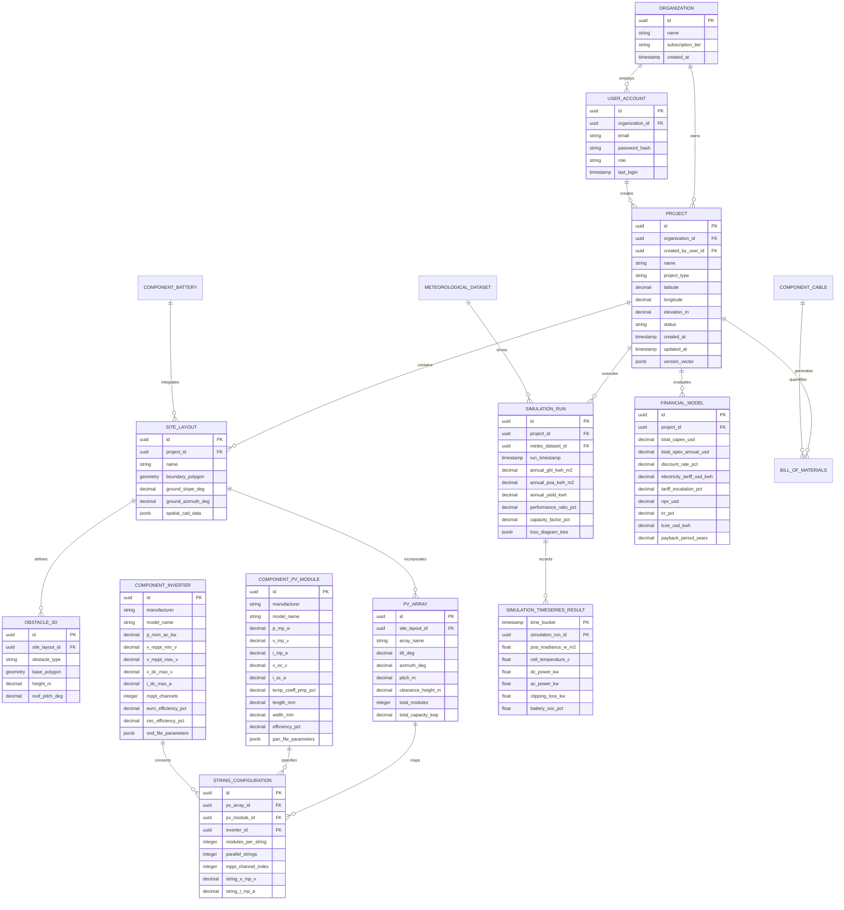

# Appendix 02: Database ERD, Data Dictionary & Offline Sync Schemas

## 1. Database Architecture Overview

The database layer utilizes a polyglot persistence architecture designed to meet disparate requirements across operational transactions, high-throughput time-series metrics, spatial CAD geometry, and offline mobile synchronization:

1. **Primary Relational Database (Cloud)**: `PostgreSQL 16` with the `PostGIS 3.4` extension for spatial spatial geometries (polygons, lat/long, site boundaries) and relational management of projects, user accounts, role-based access control, component specifications, and financial structures.
2. **Time-Series Database (Cloud)**: `TimescaleDB 2.13` (running as a hypertable extension on PostgreSQL) for managing 8760-hour annual hourly/sub-hourly meteorological datasets (GHI, DNI, DHI, wind speed, ambient temperature) and high-density simulation output vectors.
3. **Local Offline Client Database (Windows Desktop & Android Mobile)**: `SQLite 3` with `SpatiaLite` extensions, accessed via Entity Framework Core 8 and custom C# mapping layers.

---

## 2. Entity-Relationship Diagram (ERD)

The following Mermaid ERD models the core domain entities across organizations, users, projects, 3D site geometries, PV component libraries, simulation runs, and financial models.



---

## 3. Comprehensive Data Dictionary

### 3.1 Table: `PROJECT` (PostgreSQL / SQLite)
Stores top-level engineering project metadata, geospatial centroids, and offline sync control flags.

| Column Name | Data Type | Constraints | Description |
| :--- | :--- | :--- | :--- |
| `id` | `UUID` | `PRIMARY KEY, DEFAULT gen_random_uuid()` | Unique immutable project identifier. |
| `organization_id` | `UUID` | `FOREIGN KEY -> ORGANIZATION(id), NOT NULL` | Multi-tenant organization ownership. |
| `created_by_user_id`| `UUID` | `FOREIGN KEY -> USER_ACCOUNT(id), NOT NULL` | User account that authored the project. |
| `name` | `VARCHAR(255)`| `NOT NULL` | User-defined project title. |
| `project_type` | `VARCHAR(50)` | `CHECK IN ('Residential', 'C&I', 'Agricultural', 'Utility')` | System categorization scale. |
| `system_configuration`|`VARCHAR(50)`|`CHECK IN ('GridTied', 'OffGrid', 'Hybrid')` | Electrical topology model. |
| `latitude` | `NUMERIC(9,6)`| `NOT NULL, CHECK (-90.0 TO 90.0)` | WGS84 site latitude coordinate. |
| `longitude` | `NUMERIC(9,6)`| `NOT NULL, CHECK (-180.0 TO 180.0)` | WGS84 site longitude coordinate. |
| `elevation_m` | `NUMERIC(7,2)`| `DEFAULT 0.0` | Elevation above mean sea level in meters. |
| `status` | `VARCHAR(30)` | `DEFAULT 'Draft'` | Lifecycle state: `Draft`, `Simulated`, `EPC_Approved`, `Archived`. |
| `created_at` | `TIMESTAMPTZ` | `NOT NULL, DEFAULT clock_timestamp()` | Creation audit timestamp. |
| `updated_at` | `TIMESTAMPTZ` | `NOT NULL, DEFAULT clock_timestamp()` | Last modification audit timestamp. |
| `version_vector` | `JSONB` | `NOT NULL, DEFAULT '{}'` | Vector clock JSON mapping client UUIDs to sequence numbers for CRDT sync. |
| `is_deleted` | `BOOLEAN` | `NOT NULL, DEFAULT FALSE` | Soft-delete flag for offline synchronization reconciliation. |

---

### 3.2 Table: `COMPONENT_PV_MODULE` (PostgreSQL / SQLite)
Contains technical electrical, thermal, and spatial parameters for PV solar panels extracted from manufacturers, PVFree, and CEC databases.

| Column Name | Data Type | Constraints | Description |
| :--- | :--- | :--- | :--- |
| `id` | `UUID` | `PRIMARY KEY` | Panel datasheet record identifier. |
| `manufacturer` | `VARCHAR(150)`| `NOT NULL, INDEX` | Panel manufacturer name (e.g., Jinko, Longi). |
| `model_name` | `VARCHAR(150)`| `NOT NULL, INDEX` | Specific panel model string. |
| `cell_technology` | `VARCHAR(50)` | `CHECK IN ('Mono-PERC', 'TOPCon', 'HJT', 'ThinFilm')` | Semiconductor cell technology. |
| `p_mp_w` | `NUMERIC(7,2)`| `NOT NULL, CHECK (> 0)` | Maximum power rating at STC ($1000 W/m^2, 25^\circ C, AM 1.5$) $[W]$. |
| `v_mp_v` | `NUMERIC(6,2)`| `NOT NULL, CHECK (> 0)` | Voltage at maximum power point at STC $[V]$. |
| `i_mp_a` | `NUMERIC(6,2)`| `NOT NULL, CHECK (> 0)` | Current at maximum power point at STC $[A]$. |
| `v_oc_v` | `NUMERIC(6,2)`| `NOT NULL, CHECK (> 0)` | Open circuit voltage at STC $[V]$. |
| `i_sc_a` | `NUMERIC(6,2)`| `NOT NULL, CHECK (> 0)` | Short circuit current at STC $[A]$. |
| `temp_coeff_pmp_pct`|`NUMERIC(5,3)`| `NOT NULL, CHECK (< 0)` | Power temperature coefficient $[\%/^\circ C]$. |
| `temp_coeff_voc_pct`|`NUMERIC(5,3)`| `NOT NULL, CHECK (< 0)` | Open-circuit voltage temperature coefficient $[\%/^\circ C]$. |
| `temp_coeff_isc_pct`|`NUMERIC(5,3)`| `NOT NULL, CHECK (> 0)` | Short-circuit current temperature coefficient $[\%/^\circ C]$. |
| `length_mm` | `INTEGER` | `NOT NULL, CHECK (> 0)` | Physical panel length in millimeters. |
| `width_mm` | `INTEGER` | `NOT NULL, CHECK (> 0)` | Physical panel width in millimeters. |
| `bifaciality_factor`|`NUMERIC(3,2)`| `DEFAULT 0.0, CHECK (0.0 TO 1.0)` | Bifacial rear-side efficiency factor (0.0 for monofacial). |
| `pan_file_parameters`|`JSONB` | `NULL` | Raw imported PVsyst `.PAN` parameters (diode ideality, series/shunt resistance). |

---

### 3.3 Hypertables: `SIMULATION_TIMESERIES_RESULT` (TimescaleDB)
Stores high-resolution annual 8760 simulation output vectors. Partitioned automatically by time chunks (e.g., 1-month chunks).

```sql
-- PostgreSQL / TimescaleDB Definition
CREATE TABLE simulation_timeseries_result (
    time_bucket           TIMESTAMPTZ NOT NULL,
    simulation_run_id     UUID NOT NULL,
    ghi_irradiance_w_m2   REAL NOT NULL,
    poa_irradiance_w_m2   REAL NOT NULL,
    cell_temperature_c    REAL NOT NULL,
    dc_power_kw           REAL NOT NULL,
    ac_power_kw           REAL NOT NULL,
    clipping_loss_kw      REAL NOT NULL,
    ohmic_loss_kw         REAL NOT NULL,
    battery_soc_pct       REAL NULL,
    grid_export_kw        REAL NOT NULL,
    grid_import_kw        REAL NOT NULL,
    CONSTRAINT fk_sim_run FOREIGN KEY (simulation_run_id) REFERENCES simulation_run(id) ON DELETE CASCADE
);

-- Convert standard table into TimescaleDB Hypertable
SELECT create_hypertable('simulation_timeseries_result', 'time_bucket', chunk_time_interval => INTERVAL '1 month');

-- Enable Columnar Compression for 8760 time series data (>90% storage reduction)
ALTER TABLE simulation_timeseries_result SET (
    timescaledb.compress,
    timescaledb.compress_segmentby = 'simulation_run_id',
    timescaledb.compress_orderby = 'time_bucket ASC'
);
```

---

## 4. Local SQLite Offline Schema & Sync Strategy

To achieve zero-latency offline operation on Windows and Android, the client maintains a local SQLite database that mirrors a operational subset of the cloud PostgreSQL schema.

### 4.1 Local SQLite Outbox Schema (`OfflineOutbox`)

```sql
CREATE TABLE offline_outbox (
    event_id         TEXT PRIMARY KEY, -- UUIDv4
    entity_type      TEXT NOT NULL,    -- e.g., 'Project', 'SiteLayout', 'PVArray'
    entity_id        TEXT NOT NULL,    -- UUID of the entity modified
    operation_type   TEXT NOT NULL,    -- 'INSERT', 'UPDATE', 'DELETE'
    payload_json     TEXT NOT NULL,    -- Serialized delta entity state
    created_at_utc   TEXT NOT NULL,    -- ISO 8601 string
    retry_count      INTEGER DEFAULT 0,
    last_error       TEXT NULL
);

CREATE INDEX idx_outbox_created ON offline_outbox(created_at_utc);
```

### 4.2 Offline Delta Sync & Conflict Prevention Algorithm

1. **Local Mutation Transaction**:
   * Any C# code mutating a project executes inside an SQLite local transaction:
     ```csharp
     using var tx = await localDbContext.Database.BeginTransactionAsync();
     localDbContext.Projects.Update(projectEntity);
     
     var outboxEntry = new OfflineOutboxEntry {
         EventId = Guid.NewGuid().ToString(),
         EntityType = nameof(Project),
         EntityId = projectEntity.Id.ToString(),
         OperationType = "UPDATE",
         PayloadJson = JsonSerializer.Serialize(projectEntity),
         CreatedAtUtc = DateTime.UtcNow.ToString("o")
     };
     await localDbContext.OfflineOutbox.AddAsync(outboxEntry);
     await localDbContext.SaveChangesAsync();
     await tx.CommitAsync();
     ```
2. **Sync Outbox Drain Policy**:
   * When connectivity is established (`NetworkInformation.NetworkStatusChanged`), a background job drains `OfflineOutbox` in FIFO batches of 50.
   * Payloads are sent to `POST /api/v1/sync/push`. The cloud API applies mutations using PostgreSQL row locks (`SELECT FOR UPDATE`).
   * If a version vector mismatch occurs, the cloud executes field-level merge or returns `HTTP 409 Conflict` with the server state for client side-by-side reconciliation.
