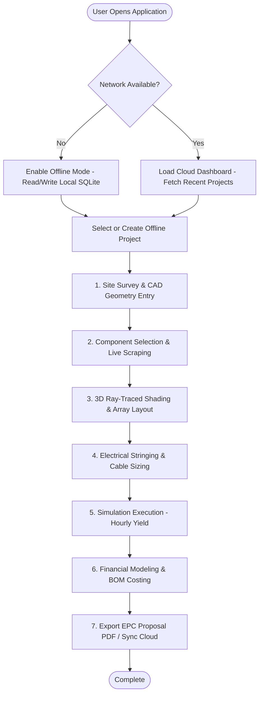

# Appendix 05: UI/UX Wireframes & Component Layout Specifications

## 1. UI/UX Design Strategy & Cross-Platform Behavior

The interface is engineered using **.NET 8 MAUI + Blazor Hybrid**, combining the flexibility of modern web UI component libraries (HTML5/CSS3/Razor) with native platform capabilities.

* **Windows Desktop Layout Strategy**: Optimized for high-density multi-monitor workstations. Uses collapsible sidebars, floating CAD toolbars, dual 2D/3D viewport split-screens, and keyboard hotkeys (e.g., `R` for Rotate, `S` for Stringing, `Space` for Ray-trace preview).
* **Android Mobile Layout Strategy**: Optimized for touch interactions and field site surveys. Uses bottom navigation bars, touch-friendly pull-up drawer cards, camera overlay for site photos, offline sync status floating badges, and high-contrast dark/light outdoor modes.

---

## 2. User Journey Flowchart



---

## 3. Screen Wireframes & ASCII Grid Layouts

---

### 3.1 Main Dashboard (`DashboardView.razor`)

#### Desktop View ASCII Layout (1920x1080 resolution)
```
+---------------------------------------------------------------------------------------------------+
|  [LOGO] SOLAR PV DESIGN STUDIO v1.0    [Search Projects...]     [Sync: ONLINE (0 Pending)]  [User]  |
+--------------+------------------------------------------------------------------------------------+
|  NAVIGATION  |  PROJECT OVERVIEW DASHBOARD                                 [+ New Project Wizard] |
|              +--------------------+--------------------+--------------------+---------------------+
|  [DASHBOARD] |  Total Capacity    |  Active Projects   |  Avg Yield / kWp   |  CO2 Offset Total   |
|  Projects    |  14.2 MWp          |  28 Projects       |  1,450 kWh/kWp     |  12,400 Tons        |
|  Component   +--------------------+--------------------+--------------------+---------------------+
|  Library     |  RECENT PROJECTS                                              [Filter: All Types v] |
|  Scraper     |  +-------------------------------------------------------------------------------+  |
|  Financials  |  | Project Name            | Type   | Capacity | Location      | Status    | Action|  |
|  Settings    |  |-------------------------|--------|----------|---------------+-----------|-------|  |
|              |  | Commercial Warehouse A  | C&I    | 450 kWp  | Madrid, ES    | Simulated | [Open]|  |
|  [OFFLINE]   |  | Residential Villa Sun   | Resi   | 12 kWp   | Munich, DE    | Draft     | [Open]|  |
|  Sync Queue  |  | Utility Solar Farm 10M  | Utility| 10 MWp   | Nevada, US    | Approved  | [Open]|  |
|  (0 events)  |  +-------------------------------------------------------------------------------+  |
|              |  SYSTEM PERFORMANCE ANALYTICS (GLOBAL)                                              |
|              |  [==== Annual Generation Comparison (2022 vs 2023 Bar Chart) ====================] |
+--------------+------------------------------------------------------------------------------------+
```

#### Android Mobile View ASCII Layout (1080x2400 resolution)
```
+------------------------------------+
| [=] PV DESIGN STUDIO   [Sync: OK]  |
+------------------------------------+
| Quick Metrics:                     |
| * 28 Projects | 14.2 MWp Capacity  |
+------------------------------------+
| RECENT PROJECTS       [+ New Proj] |
| +--------------------------------+ |
| | Commercial Warehouse A         | |
| | C&I | 450 kWp | Madrid, ES     | |
| | Status: Simulated   [Open CAD] | |
| +--------------------------------+ |
| | Residential Villa Sun          | |
| | Resi | 12 kWp | Munich, DE     | |
| | Status: Draft       [Open CAD] | |
| +--------------------------------+ |
+------------------------------------+
| BOTTOM NAV BAR                     |
| [Dashboard] [Sites] [Scrape] [Sync]|
+------------------------------------+
```

---

### 3.2 Interactive 3D Site Designer (`SiteDesigner3D.razor`)

#### Desktop CAD View Split-Screen (3D Viewport + CAD Tool Panel)
```
+---------------------------------------------------------------------------------------------------+
|  [File] [Edit] [View] [Tools] [Simulate] [Report]             [Mode: 3D CAD] [Sun Pos: 14:00 21-Jun]|
+---------------+----------------------------------------------------+------------------------------+
| TOOLBAR       | 3D VIEWPORT CANVAS (Direct3D 12 / Vulkan Native)   | CAD PROPERTIES PANEL         |
|               |                                                    |                              |
| [Select]      |         /===============================\          | SELECTED OBJECT: Roof_Zone_1 |
| [Draw Boundary|        /   [PV Array 1: 200 Modules]   /           | Area: 1,200 m2               |
| [Add Building]|       /   (Tilt: 15 deg, Azimuth: 180) /            | Pitch: 10 deg                |
| [Add Obstacle]|      /=================================/             | Azimuth: 180 deg             |
| [Add Tree]    |      |  | [HVAC Obstacle]                  |         |                              |
| [Auto-String] |      |__|__________________________________|         | ARRAY PARAMETERS             |
|               |                                                    | Module: Jinko 575W           |
| [Raytrace Sun]|  [3D Scene Controls: Rotate, Pan, Zoom, Orbit]     | Racking: Flush Roof          |
| [Shading Loss]|  [Sun Path Slider: <--- 08:00 ------||-- 18:00 --->] | Pitch: 2.2 m                 |
+---------------+----------------------------------------------------+------------------------------+
| STATUS BAR: FPS: 60 | GPU Temp: 48C | Raytraced Rays: 256/pixel | Array Capacity: 450.0 kWp     |
+---------------------------------------------------------------------------------------------------+
```

---

### 3.3 Component Library & Live Scraper Hub (`ScraperHub.razor`)

#### Component Scraping & Price Comparison Interface
```
+---------------------------------------------------------------------------------------------------+
| COMPONENT LIBRARY & SCRAPER HUB                                                                   |
+---------------------------------------------------------------------------------------------------+
| Search Query: [ Jinko Tiger Neo 575W                    ]  [Vendor: All Distributors v] [Scrape] |
+---------------------------------------------------------------------------------------------------+
| SCRAPING STATUS: Active Apify Actor -> Scraped 4 Vendors in 1.8s (Cache Up-to-Date)             |
+---------------------------------------------------------------------------------------------------+
| SCRAPED RESULTS & COMPARATIVE PRICING MATRIX                                                       |
| +-----------------------------------------------------------------------------------------------+ |
| | Manufacturer | Model           | Power | Distributor  | In Stock | Price/Unit | Action        | |
| |--------------|-----------------|-------|--------------|----------|------------|---------------| |
| | Jinko Solar  | Tiger Neo N-Type| 575W  | SolarTraders | 1,200 pcs| $112.50    | [Import Specs]| |
| | Jinko Solar  | Tiger Neo N-Type| 575W  | TiendaSolar  | 450 pcs  | $118.00    | [Import Specs]| |
| | Jinko Solar  | Tiger Neo N-Type| 575W  | Krannich     | 0 pcs    | $110.00    | [Out of Stock]| |
| +-----------------------------------------------------------------------------------------------+ |
|                                                                                                   |
| DATASHEET ELECTRICAL SPECIFICATION PREVIEW (Jinko 575W)                                          |
| Pmp: 575.0 W | Vmp: 42.22 V | Imp: 13.62 A | Voc: 50.88 V | Isc: 14.37 A | Temp Coeff Pmp: -0.30%/C |
+---------------------------------------------------------------------------------------------------+
```

---

### 3.4 Simulation Results & Yield Analytics Dashboard (`SimulationResults.razor`)

```
+---------------------------------------------------------------------------------------------------+
| ANNUAL SIMULATION RESULTS - Commercial Warehouse A (450 kWp)                     [Export PDF]     |
+--------------------+--------------------+--------------------+------------------------------------+
| Annual Generation  | Specific Yield     | Performance Ratio  | Capacity Factor                    |
| 652,400 kWh/yr     | 1,449.8 kWh/kWp    | 82.4%              | 16.5%                              |
+--------------------+--------------------+--------------------+------------------------------------+
| LOSS DIAGRAM TREE (SANKEY FLOW)                                                                   |
| [Global Irradiance: 1,750 kWh/m2] ---> (-3.2% Horizon Shading) ---> (-1.5% Soiling)               |
|   ---> [POA Irradiance: 1,820 kWh/m2] ---> (-8.1% Temp Loss) ---> (-1.2% DC Ohmic)                |
|     ---> [DC Yield: 678,000 kWh] ---> (-2.1% Inverter Efficiency) ---> [AC Yield: 652,400 kWh]    |
+---------------------------------------------------------------------------------------------------+
| MONTHLY GENERATION PROFILE (kWh)                                                                  |
| 100k|                                      _ _                                                    |
|  80k|                                    /     \                                                  |
|  60k|                         _ _       /       \       _ _                                       |
|  40k|                       /     \   /           \   /     \                                     |
|  20k|  _ _                 /       \_/             \_/       \_                 _ _               |
|    0+---|---|---|---|---|---|---|---|---|---|---|---|---|---|---|---|---|---|---|---|---|          |
|        Jan Feb Mar Apr May Jun Jul Aug Sep Oct Nov Dec                                            |
+---------------------------------------------------------------------------------------------------+
```

---

### 3.5 Financial & Report Generator Screen (`FinancialReport.razor`)

```
+---------------------------------------------------------------------------------------------------+
| FINANCIAL MODELING & EPC REPORT GENERATOR                                                         |
+---------------------------------------+-----------------------------------------------------------+
| FINANCIAL INPUT PARAMETERS            | CALCULATED EPC METRICS                                    |
| Total CAPEX ($):        [ 380,000 ]   | Net Present Value (NPV):         $ 214,500.00             |
| Annual OPEX ($/yr):     [   4,500 ]   | Internal Rate of Return (IRR):   14.8 %                   |
| Energy Tariff ($/kWh):  [   0.18  ]   | Levelized Cost (LCOE):           $ 0.054 / kWh            |
| Discount Rate (%):      [   6.0   ]   | Simple Payback Period:           5.4 Years                |
| Loan Interest (%):      [   4.5   ]   | Discounted Payback Period:       6.2 Years                |
+---------------------------------------+-----------------------------------------------------------+
| EPC PDF REPORT CUSTOMIZATION OPTIONS                                                              |
| [x] Include Cover Page & Site Image       [x] Include Single Line Diagram (SLD)                   |
| [x] Include 3D Shading Screenshots        [x] Include Bill of Materials (BOM) Itemization         |
| [x] Include 25-Year Cash Flow Table       [x] Include IEC/IEEE Compliance Checklist               |
|                                                                                                   |
|                                           [ GENERATE & DOWNLOAD EPC REPORT PDF ]                  |
+---------------------------------------------------------------------------------------------------+
```

---

## 4. UI Component Hierarchy & Razor Component Definitions

```
PVDesignStudio.Client (MAUI / Blazor Hybrid)
├── Shared/
│   ├── MainLayout.razor                # App Shell Header, Navigation Sidebar, Offline Badge
│   ├── NavMenu.razor                   # Collapsible Sidebar Links
│   └── OfflineSyncBadge.razor          # Sync status indicator & trigger button
├── Pages/
│   ├── Dashboard.razor                 # Project List & Global KPIs
│   ├── ProjectWizard.razor             # Multi-step project wizard
│   ├── SiteDesigner.razor              # 3D Native CAD Canvas Overlay
│   ├── ComponentLibrary.razor          # Manufacturer Catalog & Scraper
│   ├── SimulationDashboard.razor       # Yield analytics, charts, Sankey loss tree
│   ├── Financials.razor                # Financial cashflows & LCOE modeling
│   └── ReportExporter.razor            # PDF customization & export
└── Components/
    ├── CAD/
    │   ├── Native3DViewport.cs         # MAUI Handler wrapper for Direct3D/Vulkan
    │   └── SunPathOverlay.razor        # 2D SkiaSharp Sun Path diagram
    ├── Scraper/
    │   ├── ScraperResultCard.razor     # Individual vendor live price widget
    │   └── PriceHistoryChart.razor     # Price trend line chart
    └── Analytics/
        ├── MonthlyYieldChart.razor     # ApexCharts / Chart.js wrapper
        └── LossSankeyDiagram.razor     # Dynamic loss flow visualizer
```
